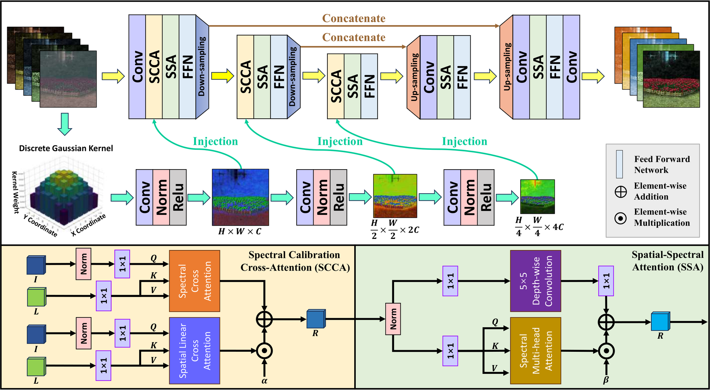
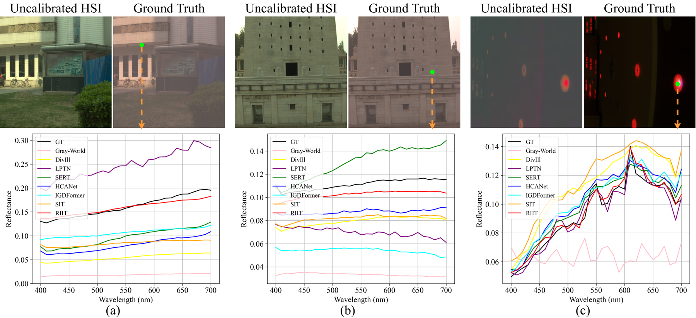
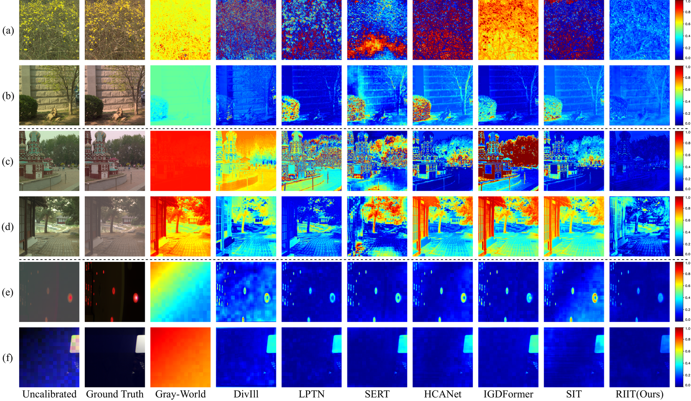

<div align="center">

# RIIT

### Reflectance–Illumination Interaction Transformer for Learning-Based Automatic Spectral Calibration of Hyperspectral Images

**Dian Li** · **Siyuan Hao** · **Cheng Fang** · **Yuanxin Ye**

*Expert Systems with Applications*, 2027

[](https://doi.org/10.1016/j.eswa.2026.134818)
[](#installation)
[](#installation)
[](LICENSE)

Official PyTorch implementation of **RIIT**, a reflectance–illumination interaction transformer for automatic spectral calibration of hyperspectral images (HSI).

</div>

---

## 📖 Overview

Hyperspectral images acquired in the wild are contaminated by **illumination**, which mixes multiplicatively with surface reflectance and corrupts the measured spectral signature. *Automatic spectral calibration* (ASC) aims to recover the intrinsic reflectance cube directly from a single uncalibrated HSI, without any white-reference panel or extra prior acquisition.

RIIT casts ASC as a **reflectance–illumination interaction** problem instead of a plain image-to-image translation:

- An **illumination stream** operates on a low-frequency observation (discrete Gaussian filtering) and produces multi-scale illumination priors at full, ½ and ¼ resolution.
- A **reflectance stream** (U-Net style transformer) restores the reflectance cube and is repeatedly *injected* with those priors through **Spectral Calibration Cross-Attention (SCCA)**.
- Each block is completed by **Spatial–Spectral Attention (SSA)** and a multi-scale feed-forward network, and the whole network is trained with a **physics-informed objective** (Charbonnier + spectral angle) that constrains spectral fidelity.

<div align="center">

<br>
<sub><b>Figure 1.</b> Overview of RIIT. Top: the asymmetric dual-stream architecture; the illumination stream (lower branch) guides the reflectance stream at three scales via SCCA injection. Bottom: details of SCCA and SSA.</sub>
</div>

---

## ✨ Highlights

| Feature | What it gives you |
|:--|:--|
| **Interaction, not fusion** | Illumination features provide the keys/values that reflectance features attend to, so calibration happens *inside* the attention rather than by naive concatenation. |
| **Two complementary attentions** | SCCA couples a spectral-axis cross-attention (channel-wise calibration) with a linear-complexity spatial cross-attention, fused by a learnable scalar α. |
| **Illumination-aware SSA** | A 5×5 depth-wise branch captures local spatial context while spectral multi-head self-attention models global band correlations, fused by a learnable scalar β. |
| **Physics-informed loss** | Charbonnier reconstruction + spectral angle loss (λ = 1.0) directly penalise spectral distortion, which is what ASC actually cares about. |
| **Lightweight** | **6.79 M** parameters and **88.3 G** MACs for a 31 × 256 × 256 input. |
| **Single-image inference** | No reference panel, no paired acquisition, no test-time optimisation — one forward pass per HSI cube. |

---

## 🧠 Method

### Components

| Module | Location | Role |
|:--|:--|:--|
| `GaussianBlurLayer` | `model/RIIT.py` | Fixed 9×9 depth-wise Gaussian kernel (σ = 3), extracts the low-frequency illumination observation. |
| `IlluminationStream` | `model/RIIT.py` | 3-stage CNN encoder (InstanceNorm + LeakyReLU) producing priors at full, ½ and ¼ resolution. |
| `SpectralCrossAttention` | `model/RIIT.py` | Spectral-axis cross-attention: reflectance features query the illumination features band-by-band. |
| `SpatialCrossAttention` | `model/RIIT.py` | Linear-complexity (ELU+1) spatial cross-attention for spatially varying illumination. |
| `SpectralAttention` | `model/RIIT.py` | Channel-wise multi-head self-attention (attention map computed over spectral channels) for global band correlation. |
| `FeedForward` | `model/RIIT.py` | 3×3×3 depth-wise conv + two dilated depth-wise convs (dilation 2 and 3), gated by GELU. |
| `PhysicsInformedLoss` | `loss/char_sam_loss.py` | `Charbonnier(pred, gt) + λ · SAM(pred, gt)`. |

### Default configuration

| Setting | Value |
|:--|:--|
| Input / output bands | 31 (400–700 nm, 10 nm step) |
| Base width `dim` | 64 |
| Transformer blocks per level | `[2, 2, 2]` |
| Attention heads | `[2, 4, 8]` |
| FFN expansion factor | 2.66 |
| Patch size during training | 256 × 256 |
| Global residual | `out = conv(x) + input` |

---

## 📊 Results

### Reproduction with the released checkpoints

Measured on the BJTU test split (116 real-world scenes) with `checkpoints/riit_dim64_bjtu.pth`; the raw log is in [`test_results/riit/test_result_riit_dim64.txt`](test_results/riit/test_result_riit_dim64.txt).

| Dataset | RMSE ↓ | PSNR ↑ | ERGAS ↓ | SAM ↓ (deg) | SSIM ↑ |
|:--|:--:|:--:|:--:|:--:|:--:|
| BJTU (real-world, 31 bands) | 0.0471 | 29.32 | 11.61 | 3.14 | 0.9114 |

> Full quantitative comparisons against Gray-World, DivIll, LPTN, SERT, HCANet, IGDFormer and SIT on BJTU, BJTU-E and ICVL are reported in the paper.

### Spectral fidelity

The recovered spectra track the reference curve, while prior methods show either a global bias (Gray-World), a spectral tilt (DivIll, LPTN) or an over-smoothed profile (SERT).

<div align="center">

<br>
<sub><b>Figure 2.</b> Reconstructed reflectance spectra at the marked pixels. RIIT (red) stays closest to the ground truth (black) across the whole 400–700 nm range.</sub>
</div>

### Qualitative comparison

<div align="center">

<br>
<sub><b>Figure 3.</b> Pseudo-colour renderings and per-pixel error maps of different calibration methods. Rows (a)–(f) cover six challenging illumination conditions.</sub>
</div>

---

## 📁 Repository structure

```text
RIIT/
├── model/
│   └── RIIT.py                 # RIIT network: illumination stream, SCCA, SSA, dual-stream blocks
├── loss/
│   └── char_sam_loss.py        # Charbonnier + spectral angle (physics-informed) loss
├── utils/
│   ├── dataset_bjtu.py         # Cached BJTU loader
│   ├── dataset_bjtu_e.py       # Cached BJTU-E loader
│   ├── dataset_icvl.py         # ICVL patch loader + deterministic split builder
│   ├── resample.py             # 204 → 31 bands spectral resampling (400–700 nm)
│   ├── split_data.py           # Materialise train/val/test folders from the split JSON
│   ├── merge.py                # Pack image pairs into memmap caches (scene_*.npy / gt_*.npy)
│   ├── get_BJTU_E.py           # Illumination simulation → BJTU-E
│   ├── create_BJTU_E_json.py   # Build the BJTU-E split JSON
│   ├── cut_ICVL.py             # ICVL .mat (v7.3) → 512 × 512 corner patches
│   └── ICVL_deg_hard.py        # Hard degradation model for ICVL
├── images/                     # Figures used in this README
├── checkpoints/                # Released pretrained weights
├── train.py                    # Training entry point (argparse)
├── trainer.py                  # Training loop
├── test.py                     # Evaluation entry point (argparse)
├── tester.py                   # Evaluation loop
├── model_ini.py                # Model / loss factory
├── metrics_torch.py            # PSNR, RMSE, SAM, ERGAS, SSIM (GPU, batched)
├── ill_sim.pkl                 # 10 measured illuminant spectra (204 bands)
├── real_light_split.json       # BJTU split: 535 / 114 / 116
├── real_light_split_bjtu_e.json # BJTU-E split: 5350 / 1140 / 1160
├── requirements.txt
├── LICENSE                     # MIT
└── README.md
```

---

<a id="installation"></a>

## ⚙️ Installation

```bash
conda create -n riit python=3.9 -y
conda activate riit

# PyTorch matching your CUDA version, e.g. CUDA 11.8
pip install torch torchvision --index-url https://download.pytorch.org/whl/cu118

pip install -r requirements.txt
```

Requirements: **Python ≥ 3.9** and **PyTorch ≥ 1.13**. Training needs a CUDA-capable GPU (multi-GPU via `DataParallel`); evaluation also runs on CPU.

---

## 🗂️ Data preparation

> ⚠️ **All scripts in `utils/` carry absolute paths at the top of the file** (e.g. `/opt/data/private/ld/data/...`). Edit them to your own directory layout before running anything.

### 1. BJTU — real-world HSI

Raw data: uncalibrated cubes `rw/rw_XXXX.npy` (204 bands, 12-bit) and reference reflectance `gt/gtRef_XXXX.npy`.

```bash
# (a) 204 → 31 bands (400–700 nm, 10 nm step), applied to both gt/ and rw/.
#     Edit input_gt / input_rw / output_* inside resample.py:main()
python utils/resample.py

# (b) (optional) materialise per-split folders for inspection
python utils/split_data.py

# (c) pack image pairs into memmap caches (edit SCENE_DIR / GT_DIR / OUT_DIR / JSON_PATH)
python utils/merge.py
```

`merge.py` produces the cache directory expected by `--merged_root`:

```text
<BJTU_ROOT>/merged_opt/
├── scene_train.npy     # (N, C, 256, 256) float32, reflectance/radiance in [0, 1]
├── gt_train.npy        # (N, C, 256, 256) float32
├── names_train.txt
├── scene_val.npy       # (N, H, W, C)  ← val/test caches are HWC
├── gt_val.npy
├── names_val.txt
├── scene_test.npy      # (N, H, W, C)
├── gt_test.npy
└── names_test.txt
```

The training split is stored as **CHW** (patches are already 256 × 256), while the val/test splits are stored as **HWC** so that full-size scenes can be evaluated without cropping. `merge.py` follows this convention automatically; the loaders verify it and raise a descriptive error on mismatch.

Split sizes (from `real_light_split.json`): **535 / 114 / 116** for train / val / test.

### 2. BJTU-E — illumination-robust extension

BJTU-E multiplies every reference cube by the 10 illuminant spectra stored in `ill_sim.pkl` (`du, sd, cd, rd, sh, ye, pu, re, bl, gr`), which yields 10× more training samples under diverse lighting.

```bash
# synthesise illuminated cubes: gtRef_1287.npy → {du,sd,...}_rw_1287.npy under BJTU_E/rw/
python utils/get_BJTU_E.py

# build the matching split JSON (every file name replicated with the 10 prefixes)
python utils/create_BJTU_E_json.py

# then run resample.py and merge.py again with the BJTU-E paths
```

Each synthesised cube `{ill}_rw_{id}.npy` shares the reference `gtRef_{id}.npy`; the reference folder therefore holds the same ten prefixed copies (the renaming helper is kept at the bottom of `get_BJTU_E.py`).

Split sizes: **5350 / 1140 / 1160**.

### 3. ICVL — simulated hard degradation

```bash
python utils/cut_ICVL.py        # .mat (v7.3) → 4 × 512×512 corner patches per scene
python utils/ICVL_deg_hard.py   # low light + coupled spatial-spectral illumination
                                # + spectral blur + shot/read noise + 12-bit quantisation
```

The ICVL loader expects plain patch pairs (no memmap cache):

```text
<ICVL_ROOT>/
├── input/     # degraded patches, (H, W, 31), 12-bit
└── target/    # clean reflectance patches, identical file names
```

Patches are normalised by `/4096` and transposed to CHW on the fly. The split is deterministic (`seed = 42`): **100 patches for validation, 100 for test**, the rest for training.

---

## 🚀 Training

```bash
# ---------- BJTU ----------
python train.py \
    --dataset_name BJTU \
    --merged_root /path/to/BJTU_resample/merged_opt \
    --method_name riit --ex_name _dim64 --dim 64 \
    --epochs 500 --batch_size 1 --lr 1e-4 \
    --save_by_epoch 10

# ---------- BJTU-E ----------
python train.py \
    --dataset_name BJTU_E \
    --merged_root /path/to/BJTU_E_resample/merged_opt \
    --method_name riit --ex_name _dim64_e --dim 64 \
    --epochs 500 --batch_size 1 --lr 1e-4

# ---------- ICVL ----------
python train.py \
    --dataset_name ICVL \
    --merged_root /path/to/ICVL_deg \
    --method_name riit --ex_name _dim64_icvl --dim 64 \
    --epochs 500 --batch_size 1 --lr 1e-4

# ---------- resume ----------
python train.py --dataset_name BJTU --merged_root /path/to/merged_opt \
    --resume_path checkpoints/riit_dim64/riit_epoch200.pth
```

**Key training settings** (defaults in `train.py`)

| Argument | Default | Meaning |
|:--|:--|:--|
| `--epochs` | 500 | Training epochs |
| `--batch_size` | 1 | Batch size **per GPU**; scaled automatically when several GPUs are given |
| `--lr` | 1e-4 | Initial Adam learning rate |
| `--lr_decrease_epoch` / `--lr_decrease_factor` | 200 / 0.5 | Halve the LR every 200 epochs |
| `--lambda_sam` | 1.0 | Weight of the spectral angle term |
| `--crop_size` | 256 | Random crop size (used by the ICVL loader; BJTU caches are pre-cropped) |
| `--save_by_epoch` | 1 | Write a checkpoint every *N* epochs |
| `--gpu_ids` | `0` | Comma-separated GPU ids, e.g. `0,1` |
| `--num_workers` | 0 | Dataloader workers |

**Outputs**

```text
checkpoints/riit_dim64/riit_epoch{N}.pth      # one checkpoint per --save_by_epoch epochs
train_loss/riit/train_loss_riit_dim64.txt     # per-epoch loss log
```

> 💡 Each checkpoint is ≈ 79 MB, so a 500-epoch run with `--save_by_epoch 1` writes ≈ 40 GB. Use `--save_by_epoch 10` (or larger) in practice.
>
> 💡 The validation routine (`val` in `trainer.py`) is implemented but currently commented out of the epoch loop, and the val loader is only built for BJTU. Uncomment the `val(...)` call to log PSNR / RMSE / ERGAS / SAM / SSIM during training.

---

## 🔍 Evaluation

```bash
python test.py \
    --dataset_name BJTU \
    --merged_root /path/to/BJTU_resample/merged_opt \
    --model_path checkpoints/riit_dim64_bjtu.pth \
    --method_name riit --ex_name _dim64 --dim 64

# BJTU-E
python test.py --dataset_name BJTU_E --merged_root /path/to/BJTU_E_resample/merged_opt \
    --model_path checkpoints/riit_dim64_bjtu_e.pth --ex_name _dim64_e

# ICVL
python test.py --dataset_name ICVL --merged_root /path/to/ICVL_deg \
    --model_path checkpoints/riit_dim64_icvl.pth --ex_name _dim64_icvl
```

Results are appended to `test_results/riit/test_result_riit{ex_name}.txt`, e.g.

```text
rmse:0.0471	psnr:29.3243	ergas:11.6121	sam:3.1384	ssim:0.9114
```

---

## 🏋️ Pretrained checkpoints

| File | Dataset | Trained epochs | Notes |
|:--|:--|:--:|:--|
| `checkpoints/riit_dim64_bjtu.pth` | BJTU | 499 | Real-world HSI, 31 bands |
| `checkpoints/riit_dim64_bjtu_e.pth` | BJTU-E | 50 | 10 illuminant conditions |
| `checkpoints/riit_dim64_icvl.pth` | ICVL | 500 | Simulated hard degradation |

All checkpoints use `dim = 64` and `num_blocks = [2, 2, 2]`. They are stored with the full training state (`model_state_dict`, `optimizer_state_dict`, `epoch`, `lr`), so they can be used both for evaluation and for resuming training.

> If the repository becomes too heavy for a plain clone, track `checkpoints/` with [Git LFS](https://git-lfs.com/) or attach the weights to a GitHub Release.

---

## 📐 Metrics

All metrics are computed on reflectance in `[0, 1]` (the 12-bit data is divided by 4096), per image and then averaged over the test set — see `metrics_torch.py`.

| Metric | Definition | Note |
|:--|:--|:--|
| **RMSE** ↓ | `sqrt(mean((R̂ − R)²))` | Lower is better |
| **PSNR** ↑ | `10·log10(1 / MSE)` | Peak value fixed to 1.0 |
| **SAM** ↓ | Mean angle between spectra, in degrees | Spectral fidelity |
| **ERGAS** ↓ | `100/r · sqrt(mean_c((RMSE_c/μ_c)²))` | `r = 4` |
| **SSIM** ↑ | Band-wise SSIM, 11×11 Gaussian window (σ = 1.5) | Structural fidelity |

---

## 📝 Citation

If you find this work useful, please consider citing:

```bibtex
@article{li2027riit,
  title     = {Reflectance--illumination interaction transformer for learning-based
               automatic spectral calibration of hyperspectral images},
  author    = {Li, Dian and Hao, Siyuan and Fang, Cheng and Ye, Yuanxin},
  journal   = {Expert Systems with Applications},
  volume    = {334},
  pages     = {134818},
  year      = {2027},
  doi       = {10.1016/j.eswa.2026.134818},
  publisher = {Elsevier}
}
```

---

## 🙏 Acknowledgements

- The **BJTU** hyperspectral dataset and the real-world illumination benchmark.
- The **ICVL** dataset (Ben-Gurion University) for the spectral image patches.
- The LayerNorm / gated feed-forward design follows [Restormer](https://github.com/swz30/Restormer); we thank the authors for releasing their code.

---

<a id="license"></a>

## ⚖️ License

This project is released under the [MIT License](LICENSE).

```text
Copyright (c) 2026 Dian Li, Siyuan Hao, Cheng Fang, Yuanxin Ye
```

You are free to use, modify and redistribute the code, including for commercial purposes, provided that the copyright notice and permission notice are retained. If you use this code in academic work, a citation to our paper is appreciated.

## 📬 Contact

**Dian Li** — [alidnnn@163.com](mailto:alidnnn@163.com) · GitHub: [@DianLi2002](https://github.com/DianLi2002)

For questions about the code, please open an issue. For questions about the paper, feel free to reach out by email.
